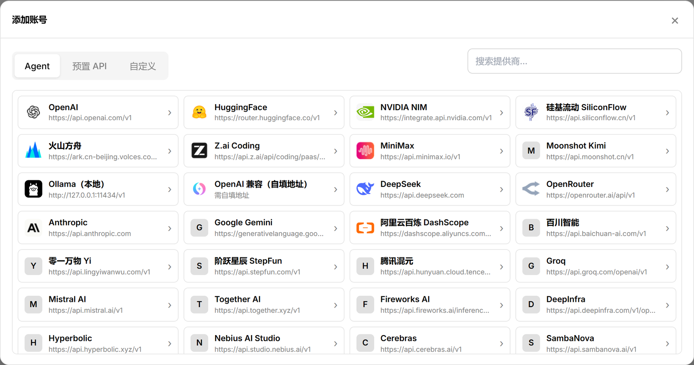
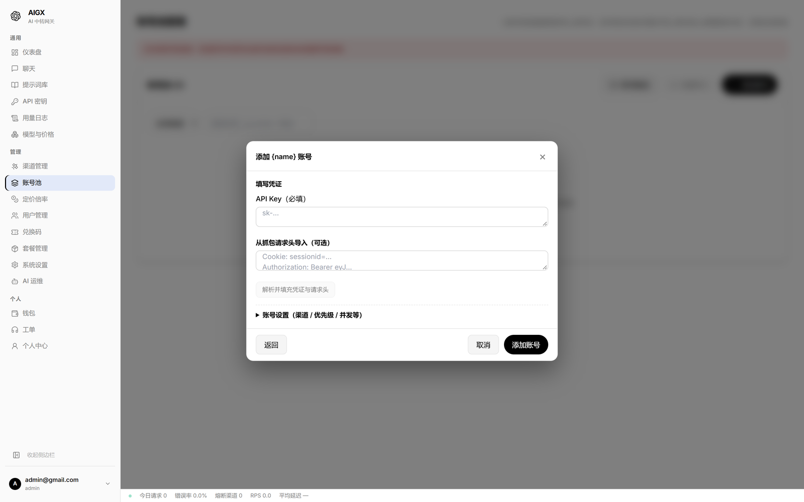
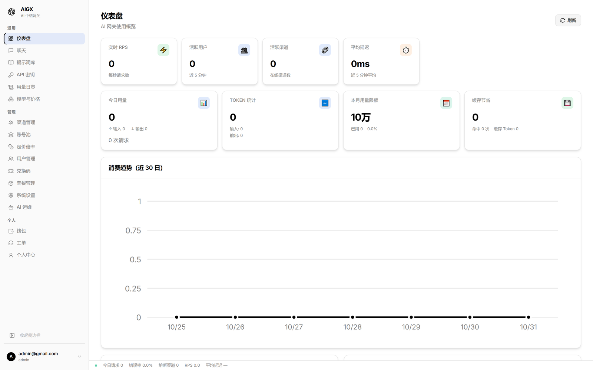

# AIGX — AI Gateway Extended

<div align="center">

**用 Rust 写的自托管 AI 网关：把多个上游模型统一成一个 OpenAI 兼容端点**

[](https://www.rust-lang.org)
[](https://react.dev)
[](#许可证)
[](https://github.com/ojbkxc/AIGX/releases/latest)
[](https://github.com/ojbkxc/AIGX/actions/workflows/ci.yml)

[English](#english) · [中文](#中文)

</div>

---

## 一句话定位

> **AIGX 是一个用 Rust 写的 AI 中转网关。** 把 Cloudflare Workers AI、OpenAI 兼容上游、Anthropic、Gemini、智谱 Z.AI 等多个上游，统一暴露成**一个 OpenAI / Anthropic 兼容的端点**；并在网关层补齐鉴权、限流、计费、调度、审计。
>
> 如果你要**自托管**，且在意**单二进制零依赖部署**与**账号池 / 断路器的稳定性设计**——AIGX 是 Rust 路线的实现选择。

**它和 new-api / one-api 最不一样的地方：**

| | AIGX | new-api | one-api |
|---|---|---|---|
| 后端 | **Rust**（Axum 0.7 + Tokio） | Go + Gin | Go |
| 交付物 | **单二进制 + 静态前端**，无外部运行时 | 单二进制（前端另需构建/挂载） | 单二进制 + 前端产物 |
| 默认存储 | **bundled SQLite**（rusqlite，编译进二进制） | SQLite / MySQL / PostgreSQL | SQLite / MySQL / PostgreSQL |
| 额外依赖 | **无**（可选切 PostgreSQL / MySQL） | 多节点推荐 Redis | 无 |
| 渠道熔断 | **断路器状态机**（Closed / Open / HalfOpen 单飞租约、失败分级冷却、流式首事件守卫） | 失败自动禁用渠道（`AutoBan`） | 无内建熔断 |
| 账号池 | **57 个内置 provider**，优先级 → 权重 → 空闲时长选号，失败**按上游真名分模型冷却**换号重试，单号独立出口代理 + 并发上限 | 单渠道多 key（轮询 / 随机两种模式） | 单 key |
| MCP / AI 运维 | **内嵌 MCP server**（19 工具白名单）+ AI 运维 Agent（45 工具 / 三级风险 / 审批矩阵） | 无 | 无 |
| 许可 | Source Available（个人非商业免费） | AGPL-3.0 + 附加条款 | MIT |

> 表格里的差异都基于各项目**当前公开源码**核对，不是印象：new-api 的多 key 走 `MultiKeyModeRandom / MultiKeyModePolling` 轮询，失败走 `ChannelStatusAutoDisabled` 整渠道禁用；AIGX 的熔断器与账号池均为独立模块（`src/channel/circuit_breaker.rs`、`src/account_session/`）。

---

## 界面预览

<details>
<summary><b>点击展开：账号池（添加账号）</b></summary>



</details>

<details>
<summary><b>点击展开：账号池（填写凭证 / 账号设置）</b></summary>



</details>

<details>
<summary><b>点击展开：仪表盘</b></summary>



</details>

> **在线 Demo**：（待部署）<!-- 部署只读演示实例后替换：<https://demo.example.com> -->

---

## 快速开始

### 方式一：Docker（最省事）

```bash
docker run -d --name aigx \
  -p 8080:8080 \
  -v aigx-data:/home/aigx/.aigx \
  --restart unless-stopped \
  docker.io/ojbkxc/ds2api:latest
```

- 镜像名是 `ds2api`（历史遗留，与仓库名不同），**多架构**（linux/amd64 + linux/arm64），压缩后约 30MB。
- 数据全部落在挂载卷 `/home/aigx/.aigx`（`config.toml` + SQLite）。
- 想接 PostgreSQL / MySQL：挂载自己的 `config.toml` 并填 `[database] url`（需按 `--features "sea-orm,postgres"` 编译），详见[部署指南](./DEPLOYMENT.md)。

### 方式二：预编译二进制

从 [GitHub Releases](https://github.com/ojbkxc/AIGX/releases) 下载对应平台二进制：

| 平台 | 资产名 |
|---|---|
| Linux x86_64 | `AIGX-1.0.30-linux-amd64` |
| Linux ARM64 | `AIGX-1.0.30-linux-arm64` |
| macOS Intel / Apple Silicon | `AIGX-1.0.30-macos-x86_64` / `AIGX-1.0.30-macos-arm64` |
| Windows x86_64 | `AIGX-1.0.30-windows-amd64.exe` |

```bash
chmod +x AIGX-1.0.30-linux-amd64
./AIGX-1.0.30-linux-amd64
```

> ⚠️ **前端是外置目录，不是打进二进制的**：管理面板需要 `static/` 与二进制**同级**。三选一拿到它：
> 1. 用 AIGX 内置的「系统设置 → 更新」解包服务器包（`.upd`，内含 `aigx` + `static/`）；
> 2. 从仓库克隆 `static/` 目录（已入库：`git clone --depth 1 https://github.com/ojbkxc/AIGX && cp -r AIGX/static .`）；
> 3. 用上面的 Docker 镜像（前端已在镜像内）。
>
> 没有 `static/` 时后端照常起，但浏览器访问根路径会 404。

启动后管理面板与数据面共用同一端口（默认 `8080`）：

- 管理面板：`http://127.0.0.1:8080/`
- 数据面入口：`http://127.0.0.1:8080/v1`

> **初始管理员**：首次启动自动创建（用户名 `admin`，密码 `123456`，邮箱 `admin@gmail.com`），并会**强制跳转改密**。生产部署后请立即改密；外网暴露请套反向代理 + TLS + 访问控制。

### 方式三：从源码构建

```bash
# 后端（默认 FileStore + bundled SQLite，零外部依赖）
cargo build --release
./target/release/aigx

# 前端（产物输出到仓库根的 static/，由后端同目录托管）
cd frontend
npm install
npm run build
```

### 对接你的应用

网关暴露标准 OpenAI / Anthropic 协议，把应用里的 Base URL 指过去、Key 换成网关「API 密钥」页面创建的令牌：

```text
Base URL: https://your-gateway.example.com/v1
API Key:  sk-xxxxxxxxxxxxxxxx
```

支持 OpenRouter / DeepSeek / Kimi / Claude Code 等主流客户端的 `base_url + api_key` 接入方式。

---

## 差异化硬核：账号池 与 断路器

这两块是绝大多数 AI 网关不做的，也是 AIGX 花大力气的地方。

### 账号池（一个渠道挂多把凭证）

一个「渠道」可以是一组上游账号的容器，而不是单个 API Key。

- **57 个内置 provider**：OpenAI、Anthropic、Gemini、DeepSeek、MiniMax、Kimi、智谱 Z.AI、火山方舟、硅基流动、OpenRouter、Groq、Cerebras、DeepInfra、Ollama、本地自填地址，以及一批 Agent 类账号（Qoder / CodeArts / Trae / AutoGLM 等）——**开箱即用，不必自己写协议适配**。
- **选号策略**：优先级分组 → 组内按权重加权随机 → **空闲越久权重越高**（避免热点账号被持续打满）。
- **失败换号**：按**上游真名分模型冷却**并换号重试（单请求轮换总预算 300s）——某个模型被限流，不会连累同账号上的其他模型。
- **单号独立出口代理**：支持 http / https / socks5，每个账号可配自己的代理。
- **单号并发上限**：账号可设 `max_concurrency`，防止单凭证被打爆。
- **运维**：批量导入、单号探活、列表内启停、清冷却、凭证独立存储 + 管理面脱敏。

<p align="center">
  
</p>

### 断路器（渠道级熔断）

不是「失败就禁用」，而是一个完整的熔断状态机：

- **状态机**：Closed → Open → HalfOpen，**HalfOpen 单飞探测**（租约机制防止并发冲击，半开期间只放一个探测请求）。
- **失败分级**：认证 / 支付类失败强制**长冷却**；限流类尊重上游返回的 `retry_after`。
- **流式首事件守卫**：SSE 流式请求若上游首事件超时，自动判失败并**切换到下一个渠道**——流式请求也能故障转移（这是很多网关做不到的）。
- **手动重置**：管理端可随时 reset 某个渠道的熔断器。
- **只读快照**：`GET /api/diagnostics/breakers` 暴露全部渠道熔断状态与半开租约。

### 调度链路

```
请求 → 优先级降序 → 同优先级按权重加权随机
     → 断路器状态修正 → 健康状态修正 → 亲和性修正
     → 账号池选号（优先级 / 权重 / 空闲）→ 上游调用
     → 失败：换号重试 → 仍失败：切下一渠道
```

---

## 完整能力清单

### 数据面（面向下游调用方）

- **OpenAI 兼容**：`/v1/chat/completions`、`/v1/responses`、`/v1/completions`、`/v1/embeddings`、`/v1/rerank`、`/v1/images/generations`、`/v1/audio/*`、`/v1/models`
- **Anthropic 原生协议**：`/v1/messages`，支持 Claude 原生格式与流式响应
- **统一 API Key**：一套密钥访问所有上游，支持模型白名单、过期时间、配额上限与 IP 限制
- **响应缓存**：相同请求命中缓存，降低上游调用成本与延迟
- **Token 估算**：BPE 级统计（`tiktoken-rs`），用于计费与限流

### 渠道与调度

- **多上游类型**：Cloudflare Workers AI（经 cf-ai-gw Worker 的 AI Binding 桥接）、OpenAI 兼容、Anthropic、Gemini、智谱 Z.AI、账号型渠道
- **智能调度**：优先级 → 权重 → 断路器 / 健康状态 / 亲和性叠加修正
- **健康巡检**：后台周期探测渠道延迟与可用性，EMA 平滑
- **AIMD 限流协同**：上游限流反馈自适应调整发送速率
- **空响应防护**：连续空响应检测与渠道降权
- **工具调用修复**：跨协议转换时的 `tool_calls` 兼容性修正
- **上游连接加固**：上游调用强制 HTTP/1.1，保证读超时可靠触发，杜绝挂连接

### 管理与计费

- **用户体系**：邮箱注册、角色权限（管理员 / 普通用户）、GitHub / Google OAuth 登录、密码找回
- **用户分组**：分组倍率、分组允许模型
- **定价引擎**：按模型定价（输入 / 输出 / 缓存命中）、模型倍率 × 分组倍率、多币种汇率、价格数据源自动同步
- **计费口径对齐**：token 用量一律取上游 `usage` 原始数据，支持 OpenAI / DeepSeek / Kimi / Anthropic 多厂商缓存字段解析，脏数据按计费恒等式收敛
- **支付充值**：易支付（Epay）与 Stripe，支持支付回调验签、订单状态管理
- **兑换码**：批量生成 / 单码生成 / 兑换充值 / 有效期管理
- **API 令牌**：创建、编辑、禁用、轮换（一次性展示新密钥）、用量重置

### 安全与可观测

- **多维度限流**：全局 / 用户 / 密钥的 RPM 与 TPM，支持窗口配置
- **IP 管理**：全局 IP 白名单 / 黑名单，支持 CIDR 网段
- **关键词护栏**：prompt / 响应关键词过滤
- **安全事件**：认证失败、限流触发、IP 拦截、滥用检测、入侵尝试，含严重程度分级
- **日志审计**：请求日志（模型、token、费用、延迟、错误）与管理员操作审计日志，支持 CSV / JSON 导出
- **上游错误脱敏**：错误响应回传前抹除上游密钥痕迹（`sk-***` / `Bearer ***`），上游凭证不泄漏给下游客户端
- **告警通知**：Telegram、SMTP（含 STARTTLS）、Slack、Webhook，后台巡检触发（断路器打开 / 渠道延迟 / 进程内存）
- **系统监控**：CPU / 内存 / 磁盘 / 网络 / 负载 / 进程采集（非 Linux 平台自动降级）
- **Prometheus 指标**：文本格式指标导出

### 架构特性

- **Rust 后端**：Axum 0.7 + Tokio 异步运行时，单二进制交付
- **React 前端**：React 18 + TypeScript（全量类型化）+ Vite，玻璃拟态管理后台，支持中英文切换与暗色主题
- **存储灵活**：默认 FileStore（bundled SQLite KV，零配置）；可选 SeaORM 接入 PostgreSQL / MySQL
- **多平台**：Linux / Windows / macOS，AMD64 / ARM64 预编译产物
- **零依赖部署**：单二进制 + 静态前端，无需外部运行时；Docker / K8s 见[部署指南](./DEPLOYMENT.md)

---

## 用 AI 运维网关（MCP + Agent）

AIGX 自带一条「AI 运维」链路：客户端（Claude Code / codex / CodeArts 等）用对话管理网关，不需要 SSH、不需要翻文档。

### 内嵌 MCP server

MCP server 挂在 `POST /api/mcp`（Streamable HTTP，JSON-RPC 2.0，MCP 2025-03-26），暴露 **19 个白名单工具**：

- 诊断 ×3：系统体检 / 渠道批量测活 / 熔断器快照
- 查询 ×4：渠道 / 用户 / 日志 / 定价
- 写 ×4：渠道启停 / 测试 / 重置熔断
- 账号池 ×6：账号列表 / 统计 / 单号探活 / 启停 / 清冷却
- 更新 ×2：版本状态 / 检查更新

白名单是**显式注册表**，未知方法与工具一律 fail-closed 拒绝；写操作全部可人工回滚，且每次调用自动写入审计日志；批量禁用 / 删用户 / 动余额 / 应用更新等高危操作**有意不在白名单内**。

**配置挂载：**

```toml
# codex CLI（~/.codex/config.toml）
[mcp_servers.aigx]
url = "http://your-gateway.example.com:8080/api/mcp"
bearer_token_env_var = "AIGX_MCP_TOKEN"   # 从环境变量读 token，勿写进配置文件
```

```bash
# Claude Code
claude mcp add --transport http aigx http://your-gateway.example.com:8080/api/mcp \
  --header "Authorization: Bearer <你的token>"
```

之后直接说人话：

- "看下系统状态" → `aigx_diagnostics_summary`
- "那个渠道挂了，禁掉它" → `aigx_channel_disable`（完成 + 自动审计留痕）
- "今天谁在用 API" → `aigx_query_logs`
- "那个账号是不是限流了" → `aigx_list_account_sessions` + `aigx_account_session_reset_cooldown`

### AI 运维 Agent（后台工作台）

管理后台内置的 Agent 工作台走的是**自举**路线：Agent 用 AIGX 自己的渠道推理，去运维 AIGX 自己。

- **45 个工具**，按风险分三层：只读 18 / 低危 13（自动执行 + 审计）/ 高危 14（挂起人工审批）
- 写操作可人工回滚，全程审计留痕 + 决策回放
- 配合 `/api/openapi.json`（OpenAPI 3.1 自描述文档，路由变更自动同步）与三个只读诊断端点（`/api/diagnostics/{summary,channels,breakers}`）形成闭环：**自发现 → 看状态 → 动手改 → 有审计**

### 服务器自动更新

管理后台「系统设置 → 更新」与 AI 运维均可检查、应用新版本：

- **检查**：读 GitHub Release（默认 `ojbkxc/AIGX`，可换仓库或自建镜像源），按 semver（含预发布段）与当前版本比较，403/429 按上游 `Retry-After` / `X-RateLimit-Reset` 冷却；
- **应用**：下载 `AIGX-{ver}-server-linux-{arch}.upd` → 校验同名 `.sha256` → 解包（仅允许 `aigx` 与 `static/`，拒绝 `..` / 绝对路径）→ 备份当前程序为 `aigx.bak`、静态目录为 `static.bak` → 写入新文件（0755）→ 延迟 2 秒 `exec` 自重启（同 PID，systemd / Docker 无需额外重启策略）；
- **回滚**：一键把 `aigx.bak` / `static.bak` 换回，重启后生效；
- **平台**：仅 Linux 服务器 / 容器支持原地更新（Windows / macOS 只检查版本）；容器内需程序目录可写。

```toml
[update]
enabled = true          # 关闭后定时任务不再检查（手动检查/更新仍可用）
auto_check = true
auto_apply = false      # 发现新版本后自动下载替换并重启（默认关闭）
interval_hours = 24
repo = "ojbkxc/AIGX"
# api_base = "https://mirror.example.com"  # 自建更新源（返回体与 GitHub API 同形）
# proxy = "http://127.0.0.1:7890"          # 访问 GitHub 的代理
# token = "ghp_xxx"                        # 提高 API 限额（匿名 60 次/小时）
# include_prerelease = false
restart_after_apply = true
```

---

## 项目结构

```text
├── src/               # Rust 后端（axum）
│   ├── api/           #   数据面 + 管理面 handler
│   ├── channel/       #   渠道存储与调度（断路器/健康/亲和/AIMD）
│   ├── account_session/ #  账号型渠道账号池（选号/冷却/并发/凭证/维护）
│   ├── egress/        #   按账号代理缓存的出口 Client 池（http/https/socks5）
│   ├── agent/         #   AI 运维 Agent（工具/审批/审计/会话）
│   ├── update/        #   服务器自动更新（Release 检测/自解包/替换/exec 自重启）
│   ├── bridge/        #   上游协议适配（cf/openai/anthropic/gemini/zai）
│   ├── pricing/       #   定价目录/汇率/价格同步
│   ├── payment/       #   易支付 + Stripe
│   ├── ratelimit/     #   RPM/TPM 多维度限流
│   ├── notify/        #   告警规则 + Telegram/SMTP/Slack/Webhook
│   └── storage/       #   FileStore / SQLite KV
├── aigx-net/          # 独立网络层 crate
├── frontend/          # React + Vite 管理后台
├── monitoring/        # 监控配置
├── docs/              # 详细文档
└── static/            # 前端构建产物（随二进制分发）
```

---

## 文档

- [业务全景](./docs/BUSINESS.md) — 模块职责、数据模型、前后端 API 契约
- [API 文档](./docs/api-documentation.md) — 完整 REST API 说明
- [网络层指南](./docs/network-layer-guide.md) — 网络层架构与使用
- [测试指南](./docs/testing-guide.md) — 测试与验证方法
- [部署指南](./DEPLOYMENT.md) — 生产环境部署
- [隐私说明](./PRIVACY.md) — 数据处理规范

---

## 参与共建

欢迎提 Issue 与 Pull Request，尤其欢迎**实际部署踩坑反馈**（不同上游的协议差异、限流行为、账号池选号策略的实际表现）。

提交前请确保：

- 后端通过 `cargo fmt` 与 `cargo clippy -- -D warnings`
- 前端通过 `npm run build`（TypeScript 严格检查）
- `static/` 产物与源码同步（CI 有闸门校验）
- 新增功能附带必要的文档更新

---

## 许可证

本项目的源代码以 **源码可用（Source Available）** 方式发布：

- ✅ **允许**：个人学习、研究、自用、非商业用途的部署与修改
- ❌ **禁止**：未经授权的商业使用，包括但不限于对外售卖、SaaS 化服务、集成到商业产品、以本项目为基础提供付费服务
- 📩 **商业授权**：如需将 AIGX 用于商业场景，请通过 [GitHub Issues](https://github.com/ojbkxc/AIGX/issues) 联系作者获取书面授权

> 本说明不构成法律意见。任何超出上述范围的使用，请务必事先与作者确认。

---

## 致谢

本项目参考与使用了以下优秀开源项目：

- [new-api](https://github.com/QuantumNous/new-api) — 功能布局参考
- [aisix](https://github.com/aisix/aisix) — Rust 实现思路参考
- [cf-ai-gw](https://github.com/o-t-w/cf-ai-gw) — UI 风格参考
- [Axum](https://github.com/tokio-rs/axum) — Rust Web 框架
- [SeaORM](https://www.sea-ql.org/SeaORM/) — Rust ORM
- [React](https://react.dev/) — UI 框架

## 免责声明

本软件按“现状”提供，作者不对其可用性、准确性或适用性作任何明示或暗示的担保；因使用本软件造成的任何损失，作者不承担责任。请在生产环境部署前自行完成安全评估与合规审查。

---

<div align="center">

**AIGX · AI Gateway Extended**

</div>

---

## English

**AIGX** is a self-hosted AI gateway written in **Rust**. It aggregates upstream AI services (Cloudflare Workers AI, OpenAI-compatible providers, Anthropic, Gemini, Zhipu Z.AI, and account-pool providers) behind a single **OpenAI / Anthropic-compatible endpoint**, adding authentication, rate limiting, group permissions, pricing, multi-channel scheduling, payments, audit logging and security monitoring.

What sets it apart from the Go-based gateways:

- **Account pool** — a channel holds many upstream credentials across 57 built-in providers; selection is priority → weight → idle time, failures cool down *per upstream model* and rotate to the next credential, and each credential can carry its own outbound proxy (http/https/socks5) and concurrency cap.
- **Circuit breaker** — a real Closed / Open / HalfOpen state machine with single-flight half-open probing, failure-tiered cooldowns (auth/payment get long cooldowns, rate limits honour `retry_after`), and a **streaming first-event guard** so SSE requests can fail over to the next channel too.
- **AI-native operations** — an embedded MCP server (`POST /api/mcp`, 19 whitelisted tools, fail-closed) plus a built-in ops Agent (45 tools, three risk tiers, human approval for destructive actions) — manage the gateway by talking to it.
- **Zero-dependency deployment** — one binary plus the static frontend; SQLite is bundled into the binary. Optional SeaORM backends for PostgreSQL / MySQL.

The source code is **free for personal, educational, research and non-commercial use**. **Commercial use (including resale, SaaS hosting, or integration into commercial products) requires prior written authorization from the author.** See [License](#许可证) for details.

For setup instructions, configuration, and API details, refer to the Chinese sections above and the [docs](./docs) directory.
